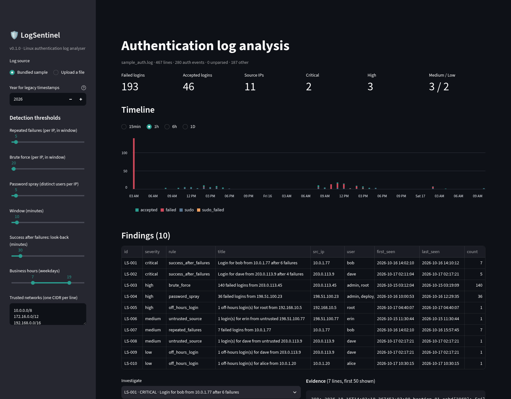
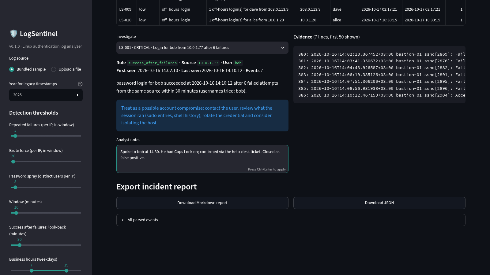

# LogSentinel

[](https://github.com/Leonard-Opasanjo/logsentinel/actions/workflows/ci.yml)
[](pyproject.toml)
[](LICENSE)

A small SIEM-style analyser for Linux authentication logs. Point it at `auth.log` or `secure` and it finds brute
force, password spraying, logins that succeed after a run of failures, off-hours access and logins from outside your
trusted networks. It then writes an incident report with the evidence lines, your analyst notes and the thresholds
used, so the result can be handed to someone else.



## The problem

Small teams run SSH on bastions and VPS hosts and nobody reads `auth.log`. When something does go wrong, the questions
are always the same: who hammered the box, did any of it get in, was the login at a sensible hour and from a sensible
place, and what do I write in the incident report. LogSentinel answers those from the log file alone, offline, with
no agents and no accounts.

## What it detects

| Rule | Triggers when (defaults) | Severity |
|---|---|---|
| `password_spray` | one source IP fails against 5 or more different usernames | high |
| `brute_force` | one source IP has 20 or more failures inside any 10-minute window | high |
| `repeated_failures` | one source IP has 5 or more failures inside any 10-minute window | medium |
| `success_after_failures` | a login succeeds within 30 minutes of 3 or more failures from the same IP | critical |
| `off_hours_login` | a login succeeds outside 07:00-19:00 on a weekday, or at the weekend | low (high for root) |
| `untrusted_source` | a login succeeds from outside the trusted networks (RFC 1918 by default) | medium (high for root) |

Each source IP gets at most one failure finding, the most serious that applies. Every threshold is a CLI flag or a
sidebar slider. Findings are numbered `LS-001`, `LS-002`, ... in severity-then-time order, so notes keyed by id stay
attached across runs with the same input and settings.

## How it works

```
src/logsentinel/
├── parser.py   auth.log lines  ->  pandas DataFrame of sshd/sudo events
├── detect.py   DataFrame + Config  ->  list[Finding]   (one function per rule, registered in RULES)
├── report.py   findings + notes  ->  Markdown / JSON incident report, hourly timeline
├── cli.py      `logsentinel analyze` and `logsentinel dashboard`
├── app.py      Streamlit dashboard (same pipeline, interactive thresholds, notes, export)
└── data/sample_auth.log   synthetic three-day log with six planted scenarios
```

The parser understands both syslog timestamp styles (`Oct 15 08:12:33` and RFC 3339 `2026-10-15T08:12:33.123456+03:00`),
`sshd` and `sshd-session` process names, gzip-rotated files, and these events: `Failed <method> for [invalid user] X`,
`Accepted <method> for X`, `sudo` commands and `sudo` failures. Everything else is counted as "other" and dropped.

## Install

Python 3.11 or newer.

```bash
git clone https://github.com/Leonard-Opasanjo/logsentinel.git
cd logsentinel
python -m venv .venv && . .venv/bin/activate     # or: uv venv && . .venv/bin/activate
pip install -e ".[dev]"                           # or: uv pip install -e ".[dev]"
```

Docker:

```bash
docker build -t logsentinel .
docker run --rm -p 8501:8501 logsentinel          # dashboard on http://localhost:8501
docker run --rm -v "$PWD/logs:/logs:ro" logsentinel logsentinel analyze /logs/auth.log
```

## Usage

Analyse a log and print the findings:

```bash
logsentinel analyze /var/log/auth.log
logsentinel analyze auth.log.2.gz --year 2025          # legacy timestamps carry no year
```

Write the incident report and the JSON evidence file, merging analyst notes:

```bash
echo '{"LS-001": "Spoke to bob. Mistyped password, confirmed by phone."}' > notes.json
logsentinel analyze auth.log --report incident.md --json incident.json --notes notes.json
```

Tune the thresholds:

```bash
logsentinel analyze auth.log --fail-threshold 10 --window 5 --business-hours 8-18 \
    --trusted-network 10.0.0.0/8 --trusted-network 203.0.113.0/24
```

Open the dashboard (upload a file or use the bundled sample, adjust thresholds, write notes, download the report):

```bash
logsentinel dashboard                 # http://localhost:8501
logsentinel dashboard --port 9000
```

## Sample output

The bundled log (`src/logsentinel/data/sample_auth.log`) is generated by `scripts/make_sample_log.py` with a fixed seed.
It covers three days on a host called `bastion-01` and plants six scenarios: a root brute force at 03:12, a
twelve-username password spray, an internal user who gets in after six failures, an external login at 02:17 on a
Saturday followed by `sudo cat /etc/shadow`, a root key login at 04:40, and a staff member working from an unknown
address. Every IP comes from the RFC 5737 documentation ranges or RFC 1918.

```
$ logsentinel analyze src/logsentinel/data/sample_auth.log --report docs/sample-report.md
sample_auth.log: 467 lines, 280 auth events, 10 findings (2 critical, 3 high, 3 medium, 2 low)
  LS-001  critical success_after_failures  Login for bob from 10.0.1.77 after 6 failures
  LS-002  critical success_after_failures  Login for dave from 203.0.113.9 after 4 failures
  LS-003  high     brute_force             140 failed logins from 203.0.113.45
  LS-004  high     password_spray          36 failed logins from 198.51.100.23
  LS-005  high     off_hours_login         1 off-hours login(s) for root from 192.168.10.5
  LS-006  medium   untrusted_source        1 login(s) for erin from untrusted 198.51.100.77
  LS-007  medium   repeated_failures       7 failed logins from 10.0.1.77
  LS-008  medium   untrusted_source        1 login(s) for dave from untrusted 203.0.113.9
  LS-009  low      off_hours_login         1 off-hours login(s) for dave from 203.0.113.9
  LS-010  low      off_hours_login         1 off-hours login(s) for alice from 10.0.1.20
report written to docs/sample-report.md
```

The full report is in [docs/sample-report.md](docs/sample-report.md) and the JSON in
[docs/sample-report.json](docs/sample-report.json). Each finding carries its rule, severity, first and last
timestamp, the evidence lines with their line numbers, a recommendation and the analyst notes.

In the dashboard, pick a finding to see its evidence, write up what you checked, and download the report with the
notes included:



## Tests and checks

```bash
ruff check .                              # lint
pytest                                    # 40 tests: parser, every rule, reports, CLI, dashboard (AppTest)
bandit -q -c pyproject.toml -r src        # static security scan
pip-audit                                 # known vulnerabilities in dependencies
python scripts/make_sample_log.py /tmp/s.log && cmp /tmp/s.log src/logsentinel/data/sample_auth.log
```

GitHub Actions runs the same five steps on Python 3.11, 3.12 and 3.13, then builds the Docker image and runs the
CLI inside it. The dependency audit is meant to fail the build when a dependency gets a published CVE.

## Security assumptions

- Log files are untrusted input. Lines are capped at 4 KiB, files at 50 MB (also after gzip decompression),
  undecodable bytes are replaced, and nothing from the log is evaluated or executed.
- Log-derived strings are sanitised before they go into the Markdown report, so a crafted username cannot break
  out of an evidence block or inject headings. The dashboard renders them through Streamlit, which escapes HTML.
- The tool makes no network calls. No IP reputation lookups, no telemetry (`gatherUsageStats` is off).
- The dashboard has no authentication. It binds to `localhost` by default; if you run it for a team, put it behind a
  reverse proxy that handles login. The Docker image binds to all interfaces inside the container because it has to.
- The container runs as an unprivileged user.

## Limitations

- Only `sshd` and `sudo` events are parsed. PAM-only lines, `su`, `login` and journald binary logs are not.
- Legacy syslog timestamps have no year; one year is applied to the whole file, so a file that spans New Year is
  misdated for one side of it.
- Timestamps are read as the host's wall-clock time. Offsets are dropped, not converted, so the business-hours rule
  reflects the server's local clock, not yours.
- Detection is threshold-based. The defaults were tuned on the synthetic sample and will need adjusting for a busy
  jump host or a NAT gateway that makes many users share one source IP.
- No baselining across runs: "unusual" means outside the trusted CIDRs, not "never seen before for this user".
- The whole file is loaded into memory. 50 MB of auth.log is a few hundred thousand lines and takes seconds; this
  is not a streaming tool for multi-gigabyte archives.

## Roadmap

- Per-user baseline of known source IPs across runs, so a new country for an existing user is a finding.
- `su`, `login`, PAM and journald (`journalctl -o short-iso`) inputs.
- GeoIP and ASN enrichment from a local MaxMind database (still no outbound calls).
- fail2ban-style block list export.
- A `--fail-on critical` exit code for cron and CI use.

## Licence

MIT. See [LICENSE](LICENSE).
